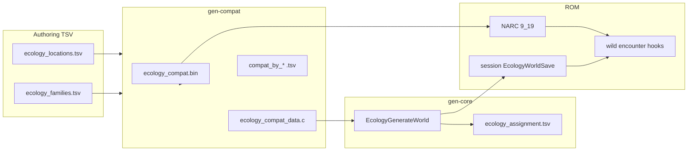

# Ecology generation (Wilds-6)

Player-facing intent lives in [DESIGN-WILDS § Wilds-6](DESIGN-WILDS.md#wilds-6-per-save-wild-ecology-shuffle). This document describes **authoring files**, **compat prebuild**, **assignment algorithm**, **runtime**, and **tooling** as implemented in hg-engine today.

Implementation recipes and ROM IDs: [HACK-NOTES § Per-save wild ecology shuffle](HACK-NOTES.md#per-save-wild-ecology-shuffle).

---

## Pipeline overview



1. Edit **`data/ecology/ecology_families.tsv`** and **`data/ecology/ecology_locations.tsv`**.
2. Run **`make ecology-compat`** (or full **`make test.nds`**, which rebuilds the blob when TSV inputs change).
3. Optional offline test: **`python scripts/dev/run_ecology_generate.py --seed 0x…`** → **`build/ecology/ecology_assignment.tsv`**.
4. In-game: first wild encounter builds the same assignment into **session memory** (seed = trainer ID).

---

## Input: `data/ecology/ecology_families.tsv`

One row per **family** (usually the base species of an evolution line). Rows with **`Special`** set and **no** **`Required on Route`** are omitted from the shuffle entirely (e.g. starters).

| Column | Meaning |
|--------|---------|
| **Index** | Dex-style id (`#0001`); stored as `dexIndex` in ROM data. |
| **Name** | Display name; must match a `SPECIES_*` enum in `include/constants/species.h`. |
| **Type1**, **Type2** | Used for **type overlap** with location `Types` (sets `type_match` on compat edges). |
| **Type (Vibe)** | Optional extra type token for overlap (e.g. thematic “Ice” on a line without Ice as Type1/2). |
| **Required Tag** | If set, family may only appear on groups whose **`Types`** include this tag (e.g. `Ice`). |
| **Avoid Tag** | Comma-separated types; if any appear in the group’s **`Types`**, the family is **excluded** from that group (all methods). |
| **Special** | `Starter`, `Static`, `Legendary`, etc. With **`Required on Route`**, row becomes **pin-only** (required placement, not general shuffle). Without required routes, row is skipped. |
| **Rarity** | Blank = **Normal**. Also: `Common`, `Rare`, `Very Rare`. Drives route **baseline** targets and fill **weights**. `Special` in this column is treated as blank. |
| **Wet/Dry** | `Wet` or `Dry` for **land / headbutt / rock smash** wet-dry rules vs location **Water** tokens. |
| **Nocturnal** | Land time mask: `Morning`, `Day`, `Night`, combinations, or `Morning/Night`. Empty = all periods. Intersected with group land periods at assign time. |
| **Pairing** | Partner family name; when one is placed, the generator tries to place the partner on the **same group** (any compatible method). Used for lines like Mantine + Remoraid. |
| **Encounter Methods** | **Not read by the current generator**; kept for design notes. Shuffle inclusion is via compat edges, not this number. |
| **Required on Route** | Comma-separated **group names** from eco-loc. Pins family to those groups (required routes + pin edges). Used for story/static slots (e.g. Unown at Ruins Inside). |
| **Headbutt**, **Rock Smash** | Non-empty = family may appear on that method where compat allows. |
| **Water type (Salt, Fresh, Cave)** | For surf/rods: allowed water tokens on the group (`Salt`, `Fresh`, `Cave`, or combined like `Fresh/Cave`, `All 3`). |
| **Fishing / Surfing** | `Surf`, `Fish`, or `Both`. Controls surf vs rod compat. **`Fish` (rod-only) is not placed on land**; `Both` may appear on land if habitat and other gates pass. |
| **Bug Catching Contest** | Marks BCC families (separate from main shuffle groups). |
| **Field**, **Mountain**, **Forest**, **Cave**, **Ruins**, **Tower** | Habitat flags; land requires match with group **`Habitat`** (see below). Cave/Tower required routes also allow **Field** habitat families on land. |

**Pairing** is resolved in gen-compat: mutual names → symmetric partners; one-way (e.g. Mantine → Remoraid) → only the naming side requires co-placement.

---

## Input: `data/ecology/ecology_locations.tsv`

One row per **placement group**: a named region that shares one ecology assignment (may map to **multiple** `ENCDATA_*` banks via **`Location`**).

| Column | Meaning |
|--------|---------|
| **Name** | Group label (e.g. `Route 29`, `Union Cave`). Used in dumps and required-route references. |
| **Location** | Comma-separated encounter symbols (`R29_ROUTE_29`, …), resolved via `include/constants/encounter_tables.h`. All listed banks share this assignment. |
| **Water** | Comma-separated: `Dry`, `Fresh`, `Salt`, `Cave`. Drives wet/dry and fishing water-type checks. |
| **Habitat** | `Field`, `Mountain`, `Forest`, `Cave`, `Ruins`, `Tower`, `City`, `Sea`, … Land habitat matching uses **`Field` / `Mountain` / `Forest` / `Cave` / `Ruins` / `Tower`** only (see gen-compat). `City` / `Sea` are labels for authoring and audit counts, not family habitat columns. |
| **Types** | Comma-separated location themes (`Ice`, `Fire`, `Bug`, …). Non-empty enables **typed land** fill (see below). Also used for Required/Avoid tags. |
| **Morning**, **Day**, **Night** | **Presence only** (`> 0` enables that period). Values like `12` are **not** slot counts; they mirror vanilla table sizing for reference. Any non-zero → land method enabled for the group. |
| **Surf**, **Old Rod**, **Good Rod**, **Super Rod**, **Rock Smash**, **Headbutt** | **Presence only** (`> 0` enables method). Numeric values are not slot counts. |
| **Radio Hoenn**, **Radio Sinnoh** | Not used by ecology gen (vanilla radio slots). |

**Skipped groups:** name contains **`Bug Catching Contest`** → not shuffled (`ECOLOGY_GROUP_FLAG_SHUFFLE` off).

**Exclusive groups:** `EXCLUSIVE_GROUP_FAMILY` in `gen_ecology_compatibility.py` (e.g. **Ruins of Alph Inside** → **Unown** only).

### Slot budgets (when a method is present)

Fixed in **`scripts/build/gen_ecology_compatibility.py`** (not per-row numbers):

| Method | Slots per group |
|--------|-----------------|
| Land | **8** (shared across Morning/Day/Night) |
| Surf | 3 |
| Old Rod | 2 |
| Good Rod | 1 |
| Super Rod | 1 |
| Headbutt | 3 |
| Rock Smash | 2 |

Totals feed **`ECOLOGY_GEN_TOTAL_SLOTS`** and **`ECOLOGY_GEN_MAX_SLOTS_PER_BUCKET`** in `include/constants/generated/ecology_compat.h`.

---

## Compat prebuild (`scripts/build/gen_ecology_compatibility.py`)

**Command:** `make ecology-compat` or dependency build of `build/ecology/ecology_compat.bin`.

### What it builds

For each `(family, group, method)` that passes the gates below, an **edge** is stored:

- **Land:** separate CSR list per group (with `type_match` flag).
- **Other methods:** shared **bucket** lists per `(group, method)`.

**Gates (summary)**

| Gate | Applies to |
|------|------------|
| Habitat (+ Field exception on Cave/Tower required land) | Land |
| Wet/Dry vs Water tokens | Land, headbutt, rock smash |
| Required Tag / Avoid Tag | Land (and tags on required routes) |
| Land time ∩ group periods | Land |
| `fish_surf == Fish` | **Excluded from land** |
| `fishing_ok` + water type | Surf, rods |
| Headbutt / Rock Smash flags | Those methods |
| Exclusive group | Only named family |
| Pin-only + Required on Route | Extra **required pin** edges |

**`ECOLOGY_COMPAT_VERSION`:** first four bytes of SHA256(**families TSV** + **locations TSV** + **slot budget string**). Bumping land slot counts changes the version so old session assignments are rejected.

### Output artifacts

| Artifact | Role |
|----------|------|
| `build/ecology/ecology_compat.bin` | Packed blob → ROM **code addon 19**, NARC `a/0/2/8` member **`9_19`**. |
| `include/constants/generated/ecology_compat.h` | Counts, structs, `ECOLOGY_GEN_TOTAL_SLOTS`, version. |
| `tools/source/ecologygen/ecology_compat_data.c` | Host **ecologygen** CSR (also linked in ROM build paths as needed). |
| `tools/source/ecologygen/ecology_strings_data.c` | Group/family name tables. |
| `include/constants/generated/ecology_strings.h` | String table declarations. |
| `data/ecology/ecology_compat_by_family.tsv` | Human audit: where each family *may* appear (by `type_match` split). |
| `data/ecology/ecology_compat_by_group.tsv` | Human audit: who *may* appear per group/method (`Fishing` merges all rod tiers). |

Commit TSV edits with regenerated **dump-***, **compat-h**, **eco-host-csr**, and **eco-strings** when authoring changes. **`ecology_compat.bin`** and **`build/ecology/ecology_assignment.tsv`** are build outputs (not committed).

---

## Assignment algorithm (`EcologyGenerateWorld` in `src/ecology_generate.c`)

Deterministic LCG (`1664525` / `1013904223`). Same seed + same compat → same world.

**Layout:** one flat array of `familyId` slots indexed by `(group, method, slotIndex)`. Empty slots stay `0xFFFF`. Land slots also get **`land_time`** masks (family nocturnal ∩ group periods).

### Phase 1 — Required routes

For each **`Required on Route`** entry in compat, place the family on every compatible method at that group (land, surf, old rod for rod families, headbutt, rock smash). Respects rod rarity rules on assign. Pairing runs where applicable.

### Phase 2 — Unplaced families

Shuffled family order. Any family with **zero** placement groups yet gets **one** compatible `(group, method)` if assign succeeds. Edge order: **50%** try **`type_match`** land edges first (shuffled within tier), then others; **50%** the reverse.

### Phase 3 — Route baseline ladder (not a cap)

Repeated passes until no progress, family order reshuffled each sweep:

| Target distinct groups | Who is eligible in this pass |
|------------------------|------------------------------|
| **1** | All rarities |
| **2** | Not Very Rare |
| **3** | Not Very Rare |
| **5** | Normal + Common |

For each family, **distinct group** = any method on that group counts once.

**Baseline minimums** (families skip passes above their tier):

| Rarity | Baseline distinct groups |
|--------|-------------------------|
| Very Rare | 1 |
| Rare | 2 |
| Normal | 3 |
| Common | 5 |

These are **floors** targeted in phase 3, **not** maximum spread. Fill may add more groups later.

**Hard cap:** **Very Rare** may only occupy **one** placement group total. Rare / Normal / Common have no group cap (255 internal limit).

Each successful ladder step adds **one slot** on a **new** group; edge pick uses the same **50/50 type-match ordering** as phase 2.

### Phase 4 — Fill

For each shuffleable group, in method order:

1. **Land:** `EcologyFillLandBucket` (typed slots first, then general pool).
2. **Other methods:** weighted random fill until bucket full or no valid pick.

**Fill weights** (Normal / Common / Rare only — **Very Rare** never picked in fill): **3 / 9 / 1**. Rarity only — no extra weight on **`type_match`**.

**Rod rarity on assign** (compat may list others; generator filters at pick time):

| Rod | Allowed rarities |
|-----|------------------|
| Old | Common only |
| Good | Common + Normal |
| Super | All |

Fill excludes **Very Rare**. Paired families need **two free slots** on the same group when placing the second half of a pair on a bucket with one slot left.

**Typed land** (group **`Types`** non-empty):

1. Target **3 × (number of type tokens)** themed slots, capped by land capacity (`ECOLOGY_TYPED_LAND_SLOTS_PER_TYPE`).
2. Until themed target met: pick only `type_match` land compat entries (rarity weights only).
3. Remaining slots: pick from **non–type_match** pool only.
4. If themed pool cannot satisfy target, fall back to general pool for unfilled themed slots.

---

## Output: assignment TSV (offline only)

**Path:** `build/ecology/ecology_assignment.tsv`  
**Tool:** `tools/ecologygen` or `scripts/dev/run_ecology_generate.py`

| Column | Meaning |
|--------|---------|
| `group_name` | Placement group |
| `method` | `Land`, `Surf`, `Old Rod`, `Good Rod`, `Super Rod`, `Rock Smash`, `Headbutt` |
| `slot_index` | 0-based index within that bucket |
| `family_name` | Assigned family |
| `base_species` | Species id for that family |
| `type_match` | 1 if land edge had theme flag |
| `land_time` | Blank = all periods at location; else comma-separated subset |

Empty slots are omitted from the file. A full world has **`ECOLOGY_GEN_TOTAL_SLOTS`** entries in memory (currently **1150** with 8 land slots).

**Audit counts:** `python scripts/dev/count_ecology_assignment.py --tsv --out build/ecology/ecology_assignment_counts.tsv` — per-family slot totals, distinct **routes** (`rt`), optional land split by location **Habitat**.

---

## Runtime (ROM)

| Piece | Location |
|-------|----------|
| Toggle | `IMPLEMENT_ECOLOGY_GENERATION` in `include/config.h` |
| Load compat | `src/ecology_load.c` → NARC blob |
| Generate | `src/ecology_script.c` → `EcologyEnsureWorldGenerated` on first wild |
| Seed | Player **trainer ID** (non-zero) |
| Storage | `EcologyWorldSave` in **session heap** (not flash yet) |
| Valid save | Magic + **`compatVersion == ECOLOGY_COMPAT_VERSION`** + **`slotCount == ECOLOGY_GEN_TOTAL_SLOTS`** |
| Encounter | `src/ecology_encounter.c`, `src/setencount_ecology.c`, `src/wild_encounter_finalize.c` |

Grass/surf/rods/headbutt/smash roll a species from the assigned bucket for the current map’s encounter bank → ecology group. Land rolls respect **time-of-day** masks. Good/Super rod hooks may merge rod tiers at encounter time (see HACK-NOTES); assignment still stores three separate rod buckets for inspection.

After **compat version**, **slot layout**, or **slot count** changes, use a **new save** or reset the emulator session so ecology regenerates.

---

## Common commands

```bat
make ecology-compat
python scripts/dev/run_ecology_generate.py --seed 0xC0FFEE
python scripts/dev/count_ecology_assignment.py --tsv
make -C tools/source/ecologygen
```

On this fork, full **`make test.nds`** is normally run via Docker (see `.cursor/rules/agents.mdc`).

---

## Related docs

- [DESIGN-WILDS § Wilds-6](DESIGN-WILDS.md#wilds-6-per-save-wild-ecology-shuffle) — player-facing rules  
- [HACK-NOTES § Per-save wild ecology shuffle](HACK-NOTES.md#per-save-wild-ecology-shuffle) — ROM addresses, overlay constraints  
- [scripts/README.md](../scripts/README.md) — script inventory  
